<p align="center">
  
</p>

<p align="center">
  <a href="https://github.com/Lala-J/P4G-P4R-Trainers/releases/latest"></a>
  <a href="https://store.steampowered.com/app/1113000/"></a>
  
  <a href="#for-developers"></a>
  <a href="LICENSE"></a>
</p>

<p align="center">
  <b>Infinite HP, any item, any Persona, social links, the case calendar,<br>
  and a dialogue autoplay that actually waits for the voice acting.</b><br>
  All from an overlay inside the game, and all done through the game's own code.
</p>

<p align="center">
  <a href="#install">Install</a> &nbsp;·&nbsp;
  <a href="#whats-on-the-channel">Features</a> &nbsp;·&nbsp;
  <a href="#autoplay-for-dialogue">Autoplay</a> &nbsp;·&nbsp;
  <a href="#playing-it-safe">Safety</a> &nbsp;·&nbsp;
  <a href="#for-developers">Developers</a>
</p>

---

Press **Insert** and the trainer opens on top of whatever you're doing: a boss fight, a dungeon
floor, a rainy night in Inaba. Change what you like, close it, carry on. It doesn't write to
your saves, it works with the game's own story checks instead of around them, and anything that
could trip up the plot tells you why before it happens.

First playthrough? Anything past where you are in the story stays hidden behind `???` until you
choose to look.

## Install

<a href="https://github.com/Lala-J/P4G-P4R-Trainers/releases/latest"></a>

You need the Steam version of Persona 4 Golden, game version 1.0.5 (the current one). Download
`P4GTrainer-vX.Y.Z.zip` from the release page. It has two folders; pick whichever suits you.

**Autoload** starts with the game every time. This is the one most people want.

1. In Steam, right-click Persona 4 Golden → **Manage** → **Browse local files**.
2. Copy `dinput8.dll` and `P4GTrainer.dll` from the zip's `Autoload` folder next to `P4G.exe`.
3. Play as usual. A few seconds after the game window appears, press **Insert** (or **L3 + R3**
   on a controller).

**Manual** loads it only when you ask.

1. Put `P4GTrainer.exe` and `P4GTrainer.dll` from the `Manual` folder anywhere, side by side.
2. Start the game, then run `P4GTrainer.exe` (at the title screen or in game, either works).
   `--wait` waits for the game to start first; `--eject` unloads it again.

> [!TIP]
> Updating? Close the game and swap in the new files. Your settings carry over.

<details>
<summary>How Autoload works, and how to turn it off</summary>
<br>

`dinput8.dll` is a tiny loader. The game picks it up in place of the Windows DLL with the same
name, it hands everything on to the real one, and then it loads `P4GTrainer.dll` from the same
folder.

- For a session without the trainer, untick **Load automatically with the game** on the
  trainer's Settings page. It applies from the next start.
- To uninstall, remove the two files. Steam's "Verify integrity of game files" leaves them
  alone, since they aren't part of the game.
- If the game gets an update the trainer doesn't recognise, the trainer stays switched off and
  the game runs normally.
</details>

### Controls

| | Keyboard | Controller |
|---|---|---|
| Open / close the trainer | `Insert` | `L3` + `R3` |
| Switch pages | `Page Up` / `Page Down` | `LB` / `RB` |
| Close | `Esc` | `Start` |
| Autoplay on / off, during a conversation | `A` | `X` / `Square` |

The mouse works everywhere too, and all of these can be rebound. The open/close combo and the
autoplay button are read from the same controller input the game uses, so they follow your
pad whichever way it's connected. While the trainer is open the game gets none of your input
(keys, clicks, mouse movement, controller), so nothing you do in the trainer can pick a menu
option behind it.

## What's on the channel

<table>
<tr>
<td width="50%" valign="top">

### ⚔️ Battle

- Infinite HP (take no damage, or just never drop below 1) and infinite SP
- No knock-downs or ailments on your party
- Enemies always miss; your party never misses and always crits
- Forced 1 More, unlimited Persona swaps, a weakness override
- Shadows can't run away

</td>
<td width="50%" valign="top">

### 🎒 Items & gear

- Every item in the game, sorted by category
- Set any count, through the game's own item routine
- Items that never run out, in battle or from the camp menu
- Equipment for Yu and the party, showing only what each of them can wield

</td>
</tr>
<tr>
<td valign="top">

### 🃏 Personas

- Edit stats and skills, for Yu's Personas and the party's
- Get any Persona Yu could hold, or let one go
- Summon from the compendium (fee optional) or register to it
- Fusion preview, worked out by the game's own fusion
- Fuse ultimates before their link is maxed

</td>
<td valign="top">

### 💛 Social links & romance

- Every link's rank and points, measured against the game's own thresholds
- "Ready to rank up" and "ready at the next hangout" at a glance
- Rank-ups that replay the link's own story effects, so the next hangout picks up where it should
- A romance guide: choose a partner by portrait and follow the route one step at a time, each step hidden until you reveal it

</td>
</tr>
<tr>
<td valign="top">

### 📅 Planning

- **Dashboard:** the date, time of day, case deadline and links ready to rank up
- **Today:** everything you can do right now and where, last chances first
- **Case File:** the current case, days left and the timeline, read from the game's own flags
- **Protagonist:** Yu's level, the five social stats with their ranks, money
- **Levels & EXP:** for Yu, the party and every Persona, through the game's level-up code

</td>
<td valign="top">

### 🗺️ Field & dungeon

- Shops and the Velvet Room from anywhere in town
- Next or previous floor, back to the entrance, party changes, the Fox's SP refill
- The whole floor revealed on the minimap
- Save anywhere
- A guard against a crash in the base game at some staircases

</td>
</tr>
<tr>
<td valign="top">

### 🔍 Enemy intel

- Every enemy's affinities filled in on the game's own Analysis screen
- A small in-battle panel with the same information
- A record of every Shadow you've met: level, stats, skills and drops

</td>
<td valign="top">

### 🛠️ Extras

- **NG+ & unlocks:** New Game+ carry-overs, one at a time
- **Undo:** every change is journaled and can be rolled back
- **Advanced:** a browser for the game's event flags and counters, with known meanings and "changed since opened"

</td>
</tr>
</table>

## Autoplay for dialogue

Turn it on, put the controller down, and let the scene play out.

- **Voiced lines play to the end.** Autoplay watches the game's audio engine and only moves on
  once the voice clip has finished, then gives you 1.5 seconds.
- **Unvoiced lines and narration** wait 2.8 seconds once the text is fully on screen. Both
  timings can be changed.
- **Only the conversation box.** Choices, menus, tutorials and pop-ups are always left to you.
- **Press `A` during a conversation** (or `X` on a controller) to switch it on or off.
  *Autoplay On* shows above the box while it's running. Outside conversations the key and the
  button do what they always do, and you can pick different ones on the Field & Dungeon page.
- Holding any key or button pauses it, and it waits while the trainer is open.
- If it ever seems stuck, open the trainer: the Field & Dungeon page shows what it was waiting
  for just before, which is the thing to put in a bug report.

## Playing it safe

> [!IMPORTANT]
> The first time the trainer loads in a session, it copies your save folder to
> `%LOCALAPPDATA%\P4GTrainer\backups\`. It never writes save files itself.

- **Risk levels on everything.** Each control is marked *Safe*, *Caution*, *Story-sensitive*
  or *Dangerous*. The last two ask first, and say exactly what will change and what could go
  wrong.
- **Warnings that make sense.** Maxing a link you haven't met yet, or one only the story should
  move? It tells you what's missing, then lets you go ahead anyway.
- **Undo** for every change.
- **No spoilers by default.** Anything past your point in the story shows as `???` until you
  reveal that one item.
- **Checks the game first.** When it loads, the trainer verifies the game build and every
  address it relies on. Anything it doesn't recognise stays switched off.
- **Free-roam only, where it matters.** Features that touch what's happening on screen right
  now (the Persona stock, shop shortcuts, floor changes) only run while you're free-roaming;
  otherwise the button tells you why not.

<details>
<summary>Things it won't do, on purpose</summary>
<br>

- **Change the date, repeat days or start arbitrary events.** The calendar and the story
  scripts don't recover from that.
- **Unlock the whole town map or "complete all quests".** Both skip rewards the scripts are
  meant to hand out.
- **Mark the playthrough as New Game+.** The story checks that in a lot of places.
- **Lift the fusion level cap.** The game checks Yu's level in a dozen places. You can get a
  higher-level Persona directly instead.
</details>

<details>
<summary>Known gaps</summary>
<br>

- *Shadows can't run away* is wired into the Shadows' own run-away logic, but hasn't been seen
  in action yet: only the rare Hand Shadows try it.
- The rescue flags for later cases come from the game's scripts. Only the first has been
  checked live.
- The files aren't code-signed, so Windows SmartScreen or an antivirus may flag them. The source
  is all here, and you can build it yourself (see below).
</details>

Settings are kept in `%LOCALAPPDATA%\P4GTrainer\settings.ini`. If something breaks,
[open an issue](https://github.com/Lala-J/P4G-P4R-Trainers/issues) and attach
`%LOCALAPPDATA%\P4GTrainer\logs\P4GTrainer.log`.

## Persona 4 Revival

The remake (P4R) gets its own trainer once it's out and there's something to look at. It will live
in [`P4R/`](P4R/). The two games share a story but not an engine, so expect a fresh build
rather than a port.

---

## For developers

Everything builds from source with free tools.

### Building

You'll need Windows 10 or 11, Visual Studio 2022 or newer with the *Desktop development with
C++* workload, Git for Windows (for Git Bash) and Python 3.

```bash
cd P4G
bash tools/fetch_deps.sh      # Dear ImGui and MinHook at pinned commits, into P4G/third_party/
bash tools/build.sh release   # or: debug
```

`build.sh` finds Visual Studio with `vswhere` and the Windows SDK through the registry, so
there are no paths to configure. It builds the DLL, the injector and the `dinput8.dll` loader,
runs the self-test and the public-repo check, and stages everything in `P4G/dist/`. To run the
public-repo check on every commit as well: `git config core.hooksPath .githooks`.

### How it's put together

- **Fail closed.** `HostCheck` verifies the executable, its build timestamp and section layout,
  then checks every entry in `Addresses.h` against the bytes it expects. An unknown build
  leaves the trainer dormant; a failed check only disables the features that depend on it.
- **Provenance.** Every address says where it came from: `[DRV]` derived here by disassembly,
  `[MOD:<repo>]` from a public mod, `[CT:<table>]` from a Cheat Engine table. All of them are
  re-verified against the target build before use.
- **Game code first.** Changes go through the game's own functions, or replay exactly what its
  scripts do. Raw memory writes are the last resort, and only for plain values.
- **The protector.** P4G's real code lives in `.shared`; `.arch` holds the protector's
  virtualised code. Functions that jump into `.arch` may be called but are never hooked.
- **Threads.** The UI never touches game memory. Changes are queued and applied on the game's
  own thread.

What's been verified in the game is written up in [`P4G/docs/data/`](P4G/docs/data/) (input,
dialogue boxes and voices, case flags, link events, the minimap and more), and the research the
address table is built on is in [`P4G/docs/research/`](P4G/docs/research/).

<details>
<summary>Repository layout</summary>

```
README.md, LICENSE           this file; MIT licence
.github/assets/              the banner
tools/check_public.py        blocks commits containing local paths, account ids, emails, keys or game assets
.githooks/pre-commit         runs check_public on staged files (opt-in)
P4G/
  src/dll/                   the trainer (injected DLL)
    Engine/                  Addresses.h (audited address table), HostCheck, SigScan, SaveBackup,
                             GameThread (work queued onto the game's thread), FlowCaller (calls the
                             game's own script functions), Natives, GameState (per-frame snapshot)
    Features/                one module per feature (Battle, BattleOverrides, Inventory, PersonaStock,
                             SocialLinks, Levels, FieldQol, AutoAdvance, EnemyIntel, Journal, ...)
    Data/                    small tables: links, cases, romance routes, today's activities,
                             generated link side effects (*.inc)
    Hooks/                   MinHook wrapper, D3D11 Present, input (DirectInput8, XInput, the game's
                             pad read, window, wheel)
    UI/                      overlay, theme, shell, portraits and pages
    Core/, Util/             lifecycle, logging, paths, settings, CPK/PAK/TMX readers
  src/injector/              P4GTrainer.exe (attach / eject / hot-swap)
  src/proxy/                 dinput8.dll: the game-folder loader (forwards to the system dinput8,
                             then loads P4GTrainer.dll once the game window is up)
  src/tests/                 headless self-test, run by the build
  tools/                     env.sh, build.sh, fetch_deps.sh, package.sh
  tools/re/                  read-only reverse-engineering helpers and test drivers (screenshots,
                             keys, clicks, title screen, auto-fight; they refuse to act on save screens)
  tools/datamine/            CPK and flowscript readers that mine social link side effects from the
                             player's own data files (output: src/dll/Data/*.inc, docs/data/)
  docs/research/             research notes the address table and rules are based on
  docs/data/                 what was verified in the game
P4R/                         placeholder for the remake
```
</details>

<details>
<summary>Making a release</summary>
<br>

Versions follow [semantic versioning](https://semver.org/). The current one is in
`P4G/VERSION`, and shows up on the trainer's About page, in its log and in `P4GTrainer.exe`.

1. Bump `P4G/VERSION` (patch for fixes, minor for new features) and commit.
2. Run `bash P4G/tools/package.sh`. It builds a release and writes `P4G/build/package/`:
   `P4GTrainer-vX.Y.Z.zip` (the `Autoload` and `Manual` folders, `INSTALL.txt`, README and
   LICENSE) and `P4GTrainer-vX.Y.Z-symbols.zip` (the matching `.pdb` files, for crash reports).
   It refuses uncommitted changes, and fails if a binary contains a local path.
3. Tag `vX.Y.Z`, push, and attach both zips to a GitHub release.
</details>

### Contributing

- **Keep it public-safe.** No absolute paths, user names, account ids, emails or keys; discover
  locations at run time. `tools/check_public.py` enforces this.
- **No game content.** No executables, extracted files, scripts, textures or portraits. Facts
  about the game, like flag numbers and addresses, are fine. Names and images are read from the
  player's own install at run time.
- **No deletions in scripts.** The build overwrites in place and moves stale files to `.trash/`,
  which is git-ignored.
- **Verify before trusting.** A new address needs a check in `Addresses.h` and a provenance tag.
- **Test it in the game.** Build with `tools/build.sh`, try the change, and read the log in
  `%LOCALAPPDATA%\P4GTrainer\logs\`.

### Credits

Built on [Dear ImGui](https://github.com/ocornut/imgui) (MIT) and
[MinHook](https://github.com/TsudaKageyu/minhook) (BSD-2). The address table and the game rules
lean on years of work by the Persona modding community: thanks to AnimatedSwine37, AquaRose7,
zarroboogs, tge, ShrineFox, rirurin, seyleonhart, DeathChaos25, qSleeP and the authors of the
Megami Tensei wikis. Their sources are linked in `P4G/docs/research/`.

---

<p align="center">
  <sub>MIT licensed. Persona 4 Golden is © ATLUS / SEGA. This is a fan project and isn't affiliated with or endorsed by them.</sub>
</p>
